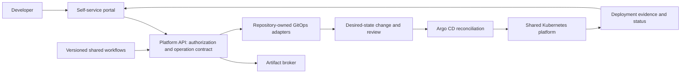

# Vercel-style Self-Service Delivery on Kubernetes

### Turning an existing GitOps platform into a developer product

A platform engineering case study by **Sai Basetti**.

Application teams should be able to connect a repository, configure a service, deploy it, see its status, and recover a previous release without becoming experts in cluster operations. This project explains my approach to building that experience on top of an existing Kubernetes and GitOps foundation.

**Current milestone:** architecture and delivery plan documented; an AI-assisted shared Helm chart proof of concept prepared and validated against existing committed manifests. Portal integration, shared-workflow consolidation, live migration, and end-to-end runtime validation remain future delivery stages.

> This is an independently written, anonymized portfolio case study. It contains no employer source code, internal links, production configuration, customer information, or operational credentials. Example names and values are fictional. It is inspired by the developer experience of Vercel; it does not describe Vercel's internal implementation or imply affiliation.

## The problem

The organization already had a shared Kubernetes platform with GitOps and Argo CD. The missing piece was a consistent developer journey:

- Application repositories carried delivery workflows that could drift apart.
- Teams repeated Deployment, Service, and Ingress configuration.
- Onboarding, promotion, and troubleshooting crossed several tools and ownership boundaries.
- A successful commit or manifest change was easy to confuse with a successful running deployment.
- Platform work existed across multiple initiatives, but contributors needed a clear starting point.

My goal was to turn those capabilities into a self-service product while retaining Git review, clear ownership, and a reversible migration path.

## My contribution

I framed the product outcome, reviewed the requirements and dependencies, selected a pilot-first approach, and broke the programme into work that could proceed independently. I directed AI-assisted research and chart implementation, examined the resulting plan and validation evidence, and established a durable handoff and decision log.

The portfolio emphasizes my engineering judgment and delivery approach. Existing delivery capabilities were team assets; I do not claim to have built the entire underlying platform or every pre-existing workflow.

## The approach

This diagram is the **target architecture**, not a claim that every integration is implemented. Builds can run from application repositories using reusable workflows; the API remains the common contract for lifecycle operations.

| Layer | Responsibility |
|---|---|
| Portal | Collect validated selections and show progress, approval state, history, and errors |
| Platform API | Authorize requests, maintain operation state, and expose one contract |
| Shared workflows | Versioned build and lifecycle clients, rather than per-application copies |
| Artifact broker | Centralize artifact verification and environment-specific registry writes |
| Shared Helm chart | Reusable resource structure, schema, and defaults |
| Application values | Service and environment differences, without copied templates |
| GitOps and Argo CD | Reviewed desired state and reconciliation |

## What I completed and what remains

| Area | Outcome represented in this case study |
|---|---|
| Requirements and roadmap | Reviewed feature areas, dependencies, conflicting assumptions, and start order |
| Delivery sequence | Prioritized workflow consolidation and chart work, with a minimum shared API contract |
| Helm POC | Shared chart and separate application/service/environment values prepared on an isolated work branch |
| Validation | Local chart linting, schema checks, manifest parity, and positive/negative tests performed during the POC |
| Evidence discipline | Distinguished local tests, committed configuration, hosted CI, and runtime proof |
| Team handoff | Recorded decisions, blockers, completed work, and pickup tasks |
| Portal and workflow integration | Target design and staged implementation plan; not claimed complete |
| Production adoption | No production migration or measured business improvement claimed |

## Explore the case study

- [Problem, responsibilities, and scope](docs/case-study.md)
- [Architecture and request lifecycle](docs/architecture.md)
- [Reusable chart and values strategy](docs/chart-strategy.md)
- [Delivery plan and team handoff](docs/delivery-plan.md)
- [Engineering decisions and tradeoffs](docs/decisions.md)
- [Validation and outcome boundaries](docs/validation-and-outcomes.md)
- [Interview stories and discussion prompts](docs/interview-guide.md)
- [Adapting the approach to another organization](docs/adoption-blueprint.md)
- [Public-content boundaries](PUBLICATION.md)

## A fictional app contract

[examples/app-spec.yaml](examples/app-spec.yaml) illustrates the kind of small input an application team could provide. It is a conceptual example, not an implemented API or deployable configuration. The repository is a documentation portfolio, not a copy of the workplace platform or a turnkey deployment product.

## Why this is useful beyond one company

The transferable pattern is to put a stable developer contract over existing delivery machinery: reuse proven capabilities, centralize repetition, make ownership explicit, and prove a narrow path before expanding. Kubernetes distribution, registry, identity provider, and secret manager can vary without changing that method.
