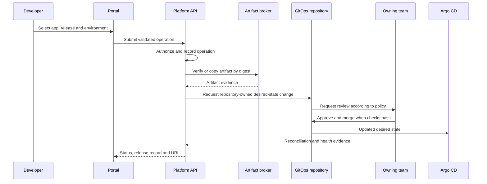

# Architecture and lifecycle

This is a proposed reference architecture, expressed independently of any employer implementation.

## One contract, several entry points

The portal, command-line client, and reusable workflows should request the same operations. Authorization, request state, and audit belong to the control plane. A workflow executes steps and reports results; it should not maintain a competing lifecycle state machine.

| Operation | Inputs | Useful completion evidence |
|---|---|---|
| Onboard | Repository, owning team, app spec, environment, exposure | Reviewed desired-state change and healthy deployment |
| Build | Source revision, build strategy | Immutable digest, scan and provenance records |
| Configure | Environment settings and secret references | Versioned configuration reconciled with no secret leakage |
| Promote | Application, tested release, destination | Required review, expected digest, healthy destination |
| Roll back | Earlier release and compatible configuration | Reviewed desired-state update and restored healthy release |

## Example deployment path

This is a conceptual sequence. Registry promotion and approval ordering must be designed for the organization's policy; the essential requirement is that unapproved requests cannot activate an unauthorized release.

## Ownership boundaries

- **Application team:** application behavior, source, service-specific settings, and routine release approval.
- **Platform team:** operation contract, baseline chart, workflow interfaces, and cross-tenant guardrails.
- **Infrastructure team:** shared network, DNS, certificate, cluster, and cloud identity capabilities.
- **Repository adapters:** translate versioned requests into resources owned by their repository.

A central workflows repository is an execution and versioning boundary. It is not a reason to grant every workflow broad infrastructure credentials.

## Release and recovery model

A release identifies an immutable artifact digest and the configuration version it expects. Promotion reuses that artifact rather than rebuilding it for each environment. Recovery updates reviewed desired state to an earlier compatible release. With GitOps reconciliation enabled, an imperative UI rollback can be undone by reconciliation; recovery must account for the source of truth.

## Failure states to design explicitly

Request rejected, queued, waiting for review, artifact unavailable, reconciliation failing, health check failing, timed out, superseded, and completed. A successful API response should mean the request was accepted unless runtime success has actually been observed.
